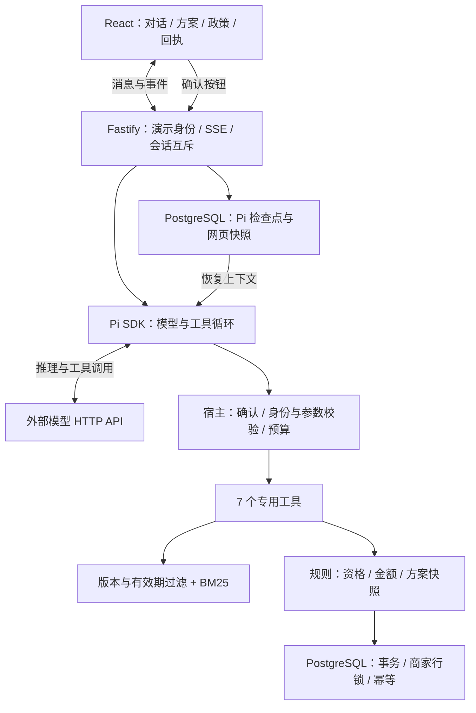
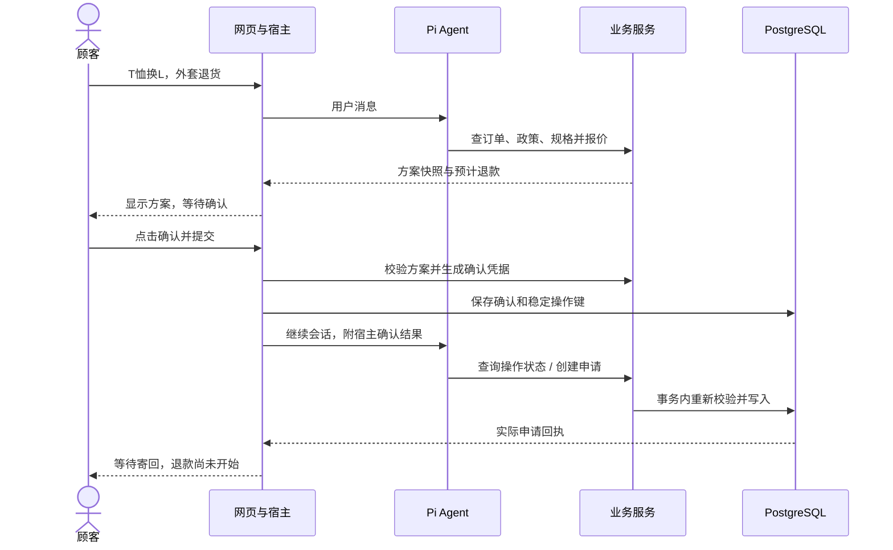

# Pi Aftercare：架构与面试讲解

## 项目解决什么问题

同一订单同时换尺码和部分退货。Agent 理解商品与数量，查可用规格和政策、生成报价，再等待用户确认。模型回复“完成”不足以证明业务成功，最终以数据库申请和订单状态为准。

## 整体架构

## 一次申请的状态变化

## 关键设计与源码

| 主题 | 实现 | 入口 |
|---|---|---|
| Agent 循环 | 模型根据工具结果选择下一步；交易约束由程序执行 | [conversation.ts](../src/agent/conversation.ts)、[tools.ts](../src/agent/tools.ts) |
| 工具权限 | 无 shell/文件/确认工具；身份来自宿主，额外校验归属和当前状态 | [tools.ts](../src/agent/tools.ts)、[aftercare.ts](../src/domain/aftercare.ts) |
| 检索与幻觉 | 按商家和有效版本过滤，BM25 返回原文、引用、版本与时间；金额由规则计算 | [policies.ts](../src/retrieval/policies.ts) |
| 人工确认 | 网页只提交 quoteId；宿主生成并持久化确认凭据与操作键，聊天不等于授权 | [web.ts](../src/http/web.ts)、[conversation.ts](../src/agent/conversation.ts) |
| 幂等与一致性 | 同键同参数返回原申请，换参数拒绝；事务内校验快照并更新订单、库存和申请 | [postgres.ts](../src/storage/postgres.ts) |
| 持久化 | Pi 原始记录、工具结果、确认及网页消息检查点；跨进程会话锁使用独立连接池 | [sessions.ts](../src/storage/sessions.ts) |
| 评测与诊断 | 状态、奖励、错误、截断、预算和逐任务记录 | [tau_adapter.py](../evals/tau_adapter.py)、[run_tau_full.py](../evals/run_tau_full.py) |

## 面试时说清的取舍

- **Pi 提供循环和上下文结构**；项目实现垂类工具、授权、事务、PostgreSQL 检查点、网页和评测。`SessionManager.inMemory(..., entries)` 是恢复后的 SDK 运行时载体，持久化由 PostgreSQL 承担。
- **超时不等于未提交**。先按原操作键查询，必要时复用同键，不能换新键盲目重做。缺失工具结果标记未知，不自动重放旧调用。
- **事务不跨模型请求**。写入时持有商家行锁；等待模型的会话锁使用独立连接池。锁粒度较粗，便于证明一致性，未做生产并发优化。
- **检索文本是数据**。工具名和 JSON Schema 只能约束接口形状，不能授权；身份、确认绑定、版本和状态校验必须在宿主与业务层落实。未声称消灭所有语义提示注入。
- **采用单 Agent**：工具范围明确、数据量小，避免增加交接和上下文成本。
- **分数对应实验**：fixture 证明协议边界；真实网页验收一个完整案例；τ-bench 75/165 是独立上游任务成绩，不能替代产品成功率。

证据与失败见[验收记录](演示与验收记录-2026-10-19.md)。
