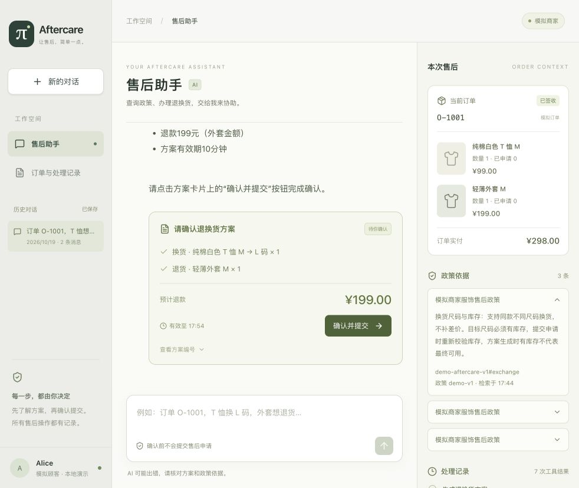
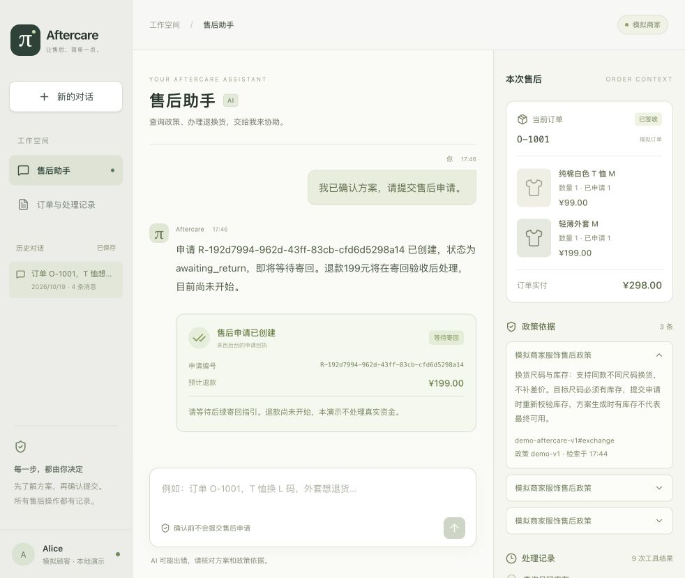
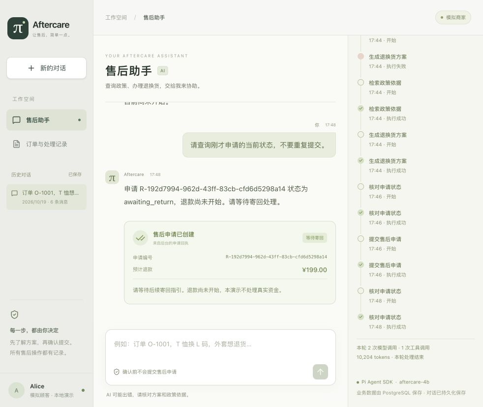

# 实习项目演示与验收记录

验收日期：2026-10-19，Asia/Shanghai。本轮只验证完整实习项目闭环、补齐材料，没有扩展业务或重新跑 165 项全量。

## 真实模型网页闭环：通过

Qwen3.5-4B BF16，独立 vLLM 服务，别名 `aftercare-4b`，32,768 上下文、每次最多输出 2,048 token，thinking 关闭。网页为正式代码，使用真实 PostgreSQL 隔离 schema `aftercare_demo_20261019`，未重置原 schema。

| 时间（北京时间） | 操作与结果 |
|---|---|
| 17:44 | 输入“订单 O-1001，T 恤换 L 码，外套退掉”；真实模型查订单、规格、政策并生成报价 |
| 确认前 | T 恤 M 换 L 1 件、外套退 1 件，预计退款 ¥199；刷新恢复消息、政策和方案，申请数仍为 0 |
| 17:46 | 点击“确认并提交”；模型查操作状态后创建申请，回执为 awaiting_return / not_started |
| 确认后 | 刷新显示同一申请；重复调用原方案确认接口返回 HTTP 409，申请数仍为 1 |
| 17:48 | 后端优雅停止并重启，网页恢复原会话；再问“查询刚才申请的当前状态，不要重复提交”，模型调用状态查询并返回同一申请 |
| 收尾 | 用新增 demo:web 入口再次启动：迁移、保留式初始化、构建和启动通过；6 条消息与同一申请保留 |

模拟数据标识：

- 会话：`c2635fd9-a7f4-4b3f-9ec4-fb61804c9da8`
- 方案：`Q-505cf1e4-60ca-4eee-bd63-88c370164820`
- 申请：`R-192d7994-962d-43ff-83cb-cfd6d5298a14`
- 退款金额：19,900 分；等待寄回，退款尚未开始。

真实轨迹包含 2 次被规则拒绝的报价，模型随后查规格和政策修正后成功。报价轮 4 次模型调用 / 7 次工具调用；提交轮 3 / 2；重启后查询轮 2 / 1。宿主没有代替模型补写申请。

### 真实截图

## 四项工程保证

| 要点 | 验证证据 | 边界 |
|---|---|---|
| 确认门禁 | 真实网页确认前申请 0、确认后 1；测试拒绝伪造确认、跨方案确认、检查点写失败后的提交 | 当前为公开本地演示身份，未实现生产登录 |
| 幂等 | 真实重复确认 409，申请数不增；PG 测试 6 个并发重试得到同一回执，重连及方案过期后仍恢复原结果 | HTTP 拒绝已消费方案，业务层同键同参数重放 |
| 超时恢复 | 故障测试覆盖写前超时不落库、提交后响应丢失先查状态及同键恢复；截断调用不执行 | 本次真实模型网页未注入超时；故障证据来自实际 Pi 循环加可控模型响应及 PG 测试 |
| 会话持久化 | 真实刷新、后端重启后继续查询；独立进程 PG 测试覆盖提交后 SIGKILL，恢复同一确认和操作键且不重放 | 保存完整 Pi 记录，不仅是网页文本；内存模式无法重启恢复 |

## 本轮检查

| 命令 | 结果 |
|---|---|
| npm run check | 50 项 Node 测试通过，3 项 PG 专用测试跳过；类型、SDK、HTTP 和构建通过 |
| npm run test:postgres | 单独真实 PG 测试 3/3 通过，隔离 schema |
| .venv/bin/python -m pytest evals/tests -q | 37/37 通过；Node PATH 回退修改后再次完整通过 |
| npm run eval -- --mode fixture --trials 3 | 8 类 × 3 次，24/24 通过 |
| npm run demo:web | 已实际启动，保留 6 条消息与原申请 |

8 类场景为 mixed、unconfirmed、out_of_stock、foreign_order、tool_error、response_lost、stale_inventory、model_error。fixture 使用模拟模型 HTTP 响应、实际 Pi SDK 和业务实现，24/24 不等于真实模型成功率 100%。首次受限沙箱重跑 Python HTTP 测试因禁止监听本机端口失败，允许本机端口后 37 项全通过，未作为模型失败计分。

## 已有评测与已知失败

| 实验 | 成绩 | 解读 |
|---|---|---|
| 上游 τ-bench test 全量，4B，4 任务并行，Agent 输出 1024 / 顾客 512 | 75/165，45.45%；retail 54/115，airline 21/50 | 全部有记录，单次 trial；153 completed、6 error、6 step_limit |
| 修正后已知失败子集，Agent 输出 2048 | 5/13；11 completed 中 6 个仍 0 分，2 step_limit，0 error | 策略、配置已变化，且只选旧失败，不能外推全量分数 |

全量中的 78 项 completed + reward=0 表示正常结束但目标未全部达成。6 个 error 包括 4 次 Agent 输出截断、1 次顾客回复不完整、1 次模型调用到限。done=False 仅说明环境尚未结束，不能单独判失败。

修正覆盖截断保护、有限写前恢复、事实校验和顾客无来源信息拦截。剩余 8 个定向失败涉及多办商品、原/目标规格混淆、动作依赖、航班或支付组合错误，以及 2 项步数到限。4B 语义审查也会误判，目前仅作审计信号。

τ-bench 路径加载上游工具与环境，没有使用售后项目的 7 个工具；成绩同时受 Agent 和用户模拟器影响，非官方榜单配置，也非本产品客户成功率。见[全量分析](评测分析-4B-vLLM四任务并行-2026-10-19.md)、[定向回归](修正回归结果-2026-10-19.md)。

## 复现与交付

从[README](../README.md)启动，新 DEMO_DATABASE_SCHEMA 可获得全新模拟订单，复用原 schema 可演示重启恢复。本机原始记录在 `.data/release-demo-*.json` 与 `.data/evals/`，不入库；[机器可读验收摘要](experiments/release-validation-2026-10-19.json)可分享。

已交付[架构与源码导航](架构与面试讲解.md)、[简历项目描述](简历项目描述.md)及三张真实截图。演示验收通过，剩余模型能力问题如实保留。
